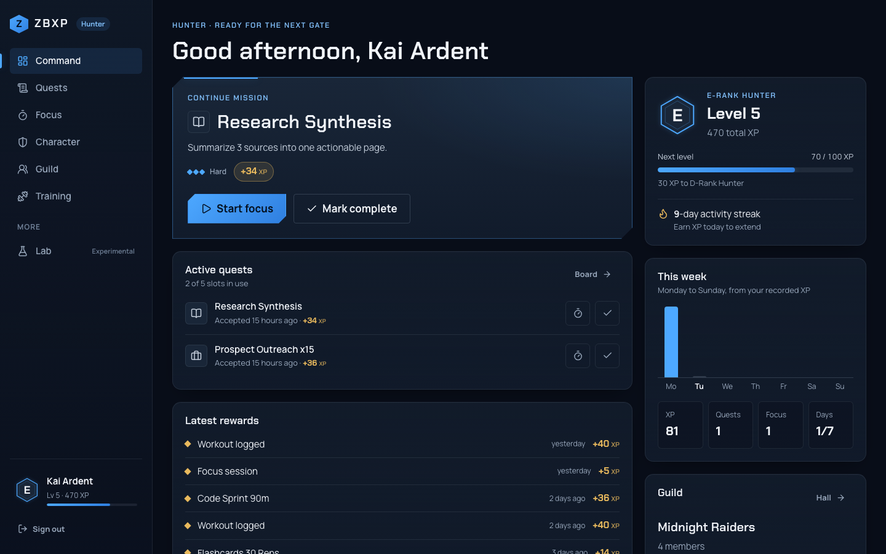
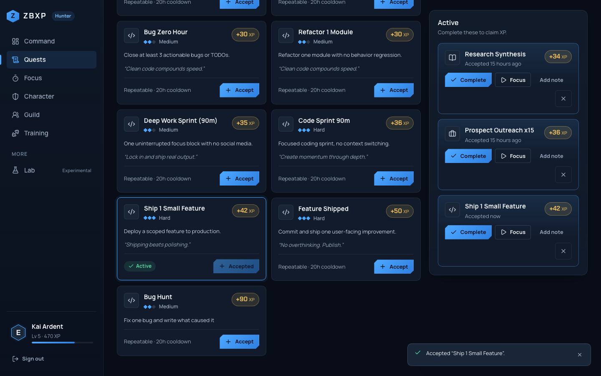
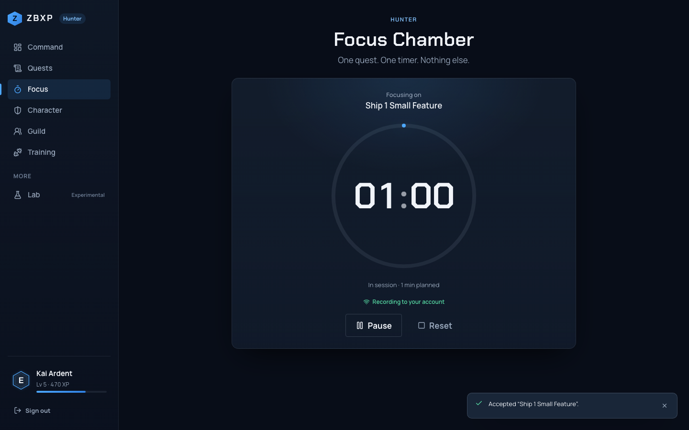
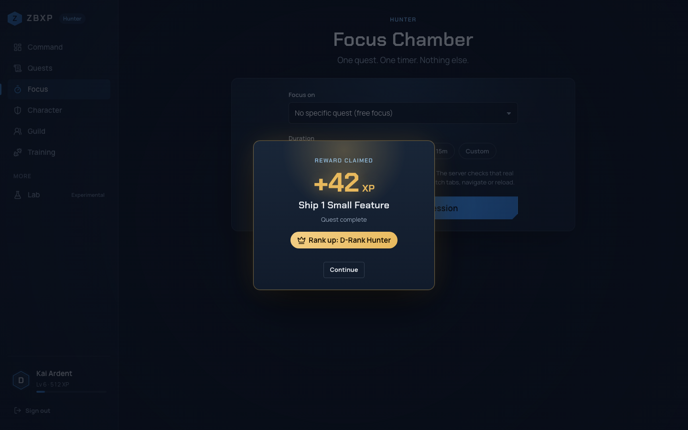
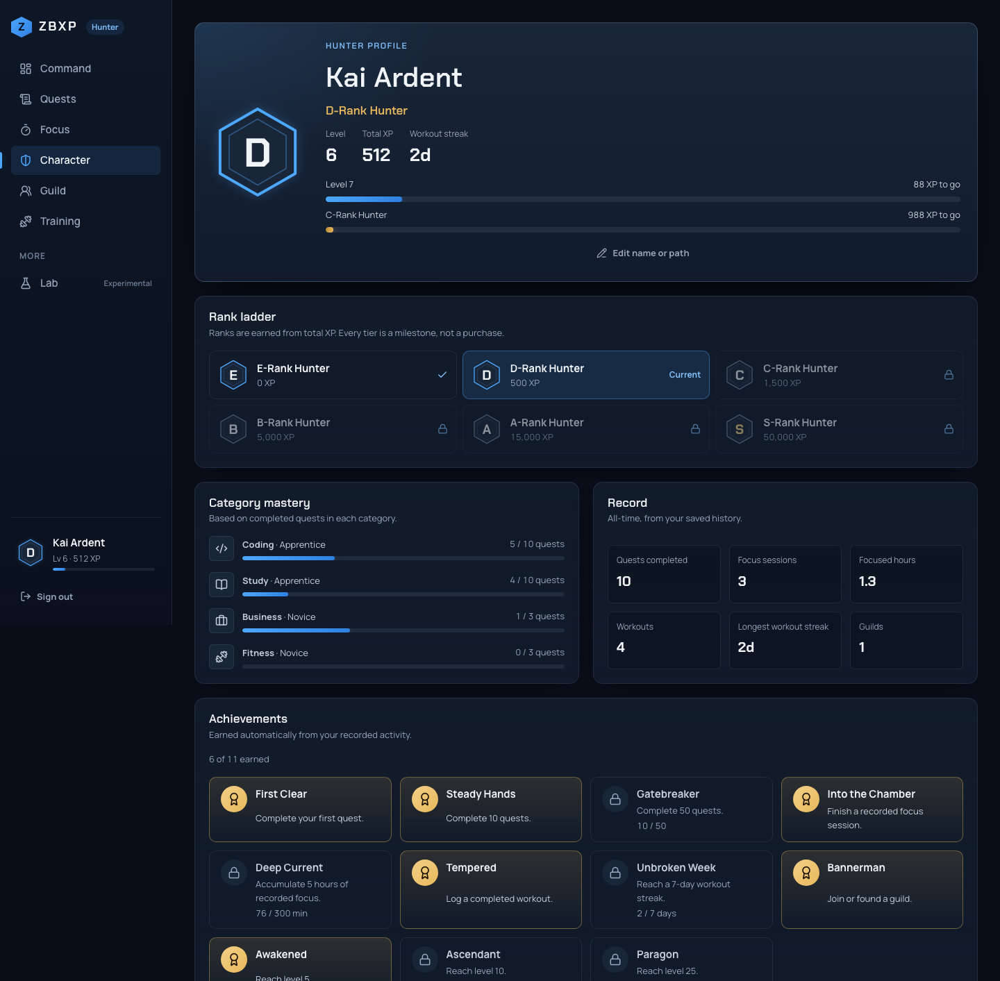
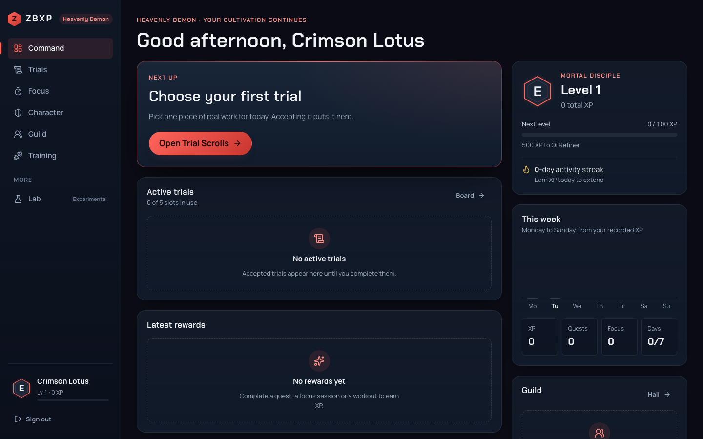

# ZBXP: Life RPG

**Turn the work you need to do into progress you can see.**

ZBXP is a productivity app with an RPG progression loop:

> Choose a quest → Focus → Complete the work → Earn XP → Level up → Compete with your guild

Pick a path (**Hunter** or **Heavenly Demon**), accept real-world quests (ship a feature, study, train, sell), run a focus session on one, complete it, and watch your character's level and rank climb. Every number on screen comes from a server-side, append-only XP ledger, so progress can't be faked from the browser.

| Command Center | Quest Board | Focus Chamber |
|---|---|---|
|  |  |  |
| **Reward** | **Character** | **Heavenly Demon theme** |
|  |  |  |

## Features

- **Command Center**: what to do next, active quests, real weekly activity, latest rewards, character progress and guild standing.
- **Quest Board**: browse by category, accept (max 5 active), complete with an optional note, abandon, and view history. Quests are repeatable after a cooldown.
- **Focus Chamber**: preset or custom sessions linked to a quest. The timer uses timestamps, so it survives navigation, reloads and background tabs. The server verifies elapsed time before awarding focus XP.
- **Character**: rank ladder, level and rank progress, category mastery and achievements, all derived from recorded activity.
- **Guild Hall**: create a guild (public or private), join by invite code or from the public directory, and see weekly and all-time leaderboards from the same ledger as your profile.
- **Training Grounds**: workout plans, a session checklist, workout logging with streaks and bonus XP, and a 4-week history grid.
- **Lab** (experimental): journal, habits, planner, reading, nutrition, goals, trading and portfolio notebooks. These are saved on the device only and clearly labelled as such.

## Stack

React 19 · Vite 8 (beta) · React Router 7 · Supabase (Auth, Postgres, RLS, RPC) · vite-plugin-pwa · Vitest · Playwright · Vercel

## Quick start (local, fully self-contained)

Requirements: Node 20+ and Docker.

```bash
npm install
npm run db:start                 # local Supabase (Postgres, Auth, API) via Docker
npx supabase status -o env       # copy API_URL / ANON_KEY / SERVICE_ROLE_KEY
```

Create two git-ignored env files from those values:

```bash
# .env.e2e.local  (used by `vite --mode e2e`)
VITE_SUPABASE_URL=http://127.0.0.1:54321
VITE_SUPABASE_ANON_KEY=<ANON_KEY>

# .env.test.local (used by tests and the demo seed)
SUPABASE_TEST_URL=http://127.0.0.1:54321
SUPABASE_TEST_ANON_KEY=<ANON_KEY>
SUPABASE_TEST_SERVICE_ROLE_KEY=<SERVICE_ROLE_KEY>
SUPABASE_TEST_DB_URL=<DB_URL>
```

Seed the demo and run the app:

```bash
export DEMO_USER_EMAIL=you@example.com DEMO_USER_PASSWORD='<12+ char secret>'
npm run demo:reset
npx vite --mode e2e               # http://localhost:5173
```

## Scripts

| Command | What it does |
|---|---|
| `npm run dev` / `build` / `preview` | Vite dev server, production build, preview |
| `npm run lint` | ESLint (including React Compiler hook rules) |
| `npm test` | Unit tests (Vitest) |
| `npm run test:integration` | DB/API tests against the **local** Supabase stack |
| `npm run test:e2e` | Playwright: full demo journey, responsive, a11y, PWA |
| `npm run db:verify` | Replays the rescue migration on legacy-shaped data and asserts the invariants (local DB only) |
| `npm run demo:seed` / `demo:reset` | Idempotent demo fixtures (local by default) |

## Documentation

- [Architecture](docs/ARCHITECTURE.md): structure, data flow, XP/quest/focus model
- [Security audit](docs/SECURITY_AUDIT.md): findings, fixes, and required owner actions
- [Deployment](docs/DEPLOYMENT.md): migration order, Vercel, PWA, rollback
- [Demo script](docs/DEMO_SCRIPT.md): 10-step walkthrough
- [Test results](docs/TEST_RESULTS.md): what was run and the results
- [Deferred features](docs/DEFERRED.md)

## Environment variables

| Variable | Where | Notes |
|---|---|---|
| `VITE_SUPABASE_URL`, `VITE_SUPABASE_ANON_KEY` | Frontend | Public by design; protected by RLS and RPC grants |
| `VITE_ENABLE_GOOGLE_AUTH` | Frontend | `true` only after enabling Google in Supabase Auth |
| `VITE_DEMO_MODE` | Frontend | `true` shows a "Demo build" note on sign-in (no credentials) |
| `SUPABASE_SERVICE_ROLE_KEY`, `DEMO_USER_*` | Scripts only | Never prefix with `VITE_`; never commit |
